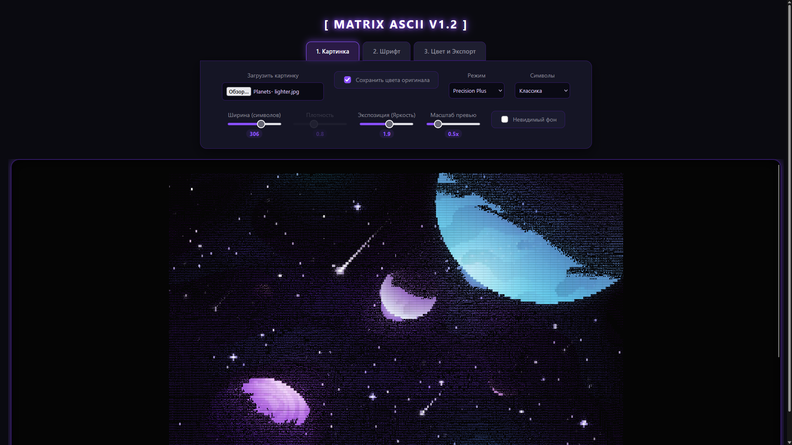

# 💻 Matrix ASCII Generator v1.0

Веб-генератор матричного ASCII-арта из любой картинки. Работает прямо в браузере, без серверов и отправки данных.

## ✨ Фичи:
- Загрузка любой картинки.
- Режимы "Матрица" (рандомные символы) и "Градиент".
- Экспорт в высоком разрешении (до 5x) в PNG, JPEG или WebP.
- Поддержка кастомных шрифтов (.ttf, .otf) с выравниванием по сетке.
- Копирование чистого текста с невидимыми символами (Braille Blank).

## 🚀 Как запустить:
Просто откройте `index.html` в браузере.

## 👨‍💻 Автор
[Violet-core]
